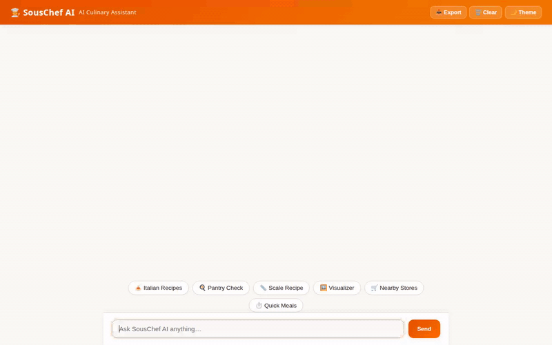

# SousChef AI 👨‍🍳

An intelligent, multi-modal AI culinary assistant built on Google Cloud's **Agent Development Kit (ADK)** and powered by **Gemini 2.5 Flash** and **Google Omni**. SousChef AI acts as a personal kitchen assistant that remembers dietary restrictions, discovers recipes, scales ingredients, manages pantry inventory, locates nearby grocery stores, generates food photography, and produces short culinary video clips.



---

## 🌟 Implemented Capabilities & Tools

SousChef AI's capabilities are backed by tools defined in `app/agent.py` and integrated with Google Cloud services:

* **🧠 Persistent Memory Bank (`PreloadMemoryTool` & `generate_memories_callback`)**: Automatically extracts and retains user food allergies, health sensitivities, and dietary preferences across sessions, ensuring all recipe recommendations strictly respect health constraints.
* **📖 Firestore Recipe Management (`search_recipes`, `add_recipe`, `scale_recipe_servings`)**: Connects directly to Google Cloud Firestore to query local recipe collections, save new culinary entries, and compute exact scaled ingredient quantities using a Python code execution sandbox.
* **🌐 Global Recipe Search (`search_online_recipes`)**: Integrates with TheMealDB API to fetch recipes and cooking instructions from around the world.
* **🥫 Pantry Inventory Management (`get_pantry_inventory`, `add_pantry_item`)**: Reads and updates pantry items stored in Firestore to recommend dishes based on available ingredients.
* **📍 Supermarket & Grocery Store Discovery (`geocode_address`, `find_nearby_places`)**: Leverages Google Maps Geocoding & Google Places API (New) to locate nearby supermarkets, organic markets, and grocery stores given a user's location.
* **🖼️ AI Food Photography Generation (`generate_dish_image`)**: Generates high-resolution food photography using Gemini on Vertex AI. Saves generated images as Playground artifacts via `tool_context.save_artifact` and uploads public image assets to Google Cloud Storage.
* **🎬 Culinary Video Generation (`generate_culinary_video`)**: Generates short cooking video clips using Google's Omni model (`gemini-omni-flash-preview` in the `global` region). Saves video clips as Playground artifacts and uploads media bytes to Google Cloud Storage.
* **🎨 Agent-to-UI (A2UI) Rich Interface (`a2ui_callback` & `BasicCatalog`)**: Streams rich, interactive UI components (cards, recipe details, image galleries, and action buttons) directly into the chat interface.

---

## ☁️ Google Cloud & External Services Architecture

| Service / API | Implementation Purpose |
| :--- | :--- |
| **Agent Runtime / Reasoning Engine** | Hosting environment for the deployed ADK agent |
| **Gemini 2.5 Flash** | Core reasoning LLM (`gemini-2.5-flash`) |
| **Google Omni (`gemini-omni-flash-preview`)** | Omni-modal video generation engine |
| **Google Cloud Firestore** | NoSQL database for recipes, user preferences, and pantry items |
| **Google Cloud Storage (GCS)** | Public media storage bucket for generated dish photos and videos |
| **Google Maps & Places API (New)** | Geocoding and spatial place search for grocery stores |
| **TheMealDB API** | External recipe data provider |
| **FastAPI + HTML5/CSS3 UI** | Light-weight proxy and plain chat web UI with Dark Mode |

---

## 🚀 Local Development & Setup

### Prerequisites

* Python 3.11+
* `uv` package manager
* `agents-cli` (`uv tool install google-agents-cli`)
* Google Cloud SDK (`gcloud`) authenticated to your GCP project

### Environment Configuration

Create a `.env` file in the project root:

```env
GOOGLE_GENAI_USE_VERTEXAI=true
GOOGLE_CLOUD_PROJECT=your-gcp-project-id
GOOGLE_CLOUD_LOCATION=global
GOOGLE_MAPS_API_KEY=your-google-maps-api-key
```

### Installation

Install dependencies using `agents-cli`:

```bash
agents-cli install
```

### Running Locally

#### 1. Launch ADK Playground (Agent Dev UI)

To test the agent directly in the ADK developer environment:

```bash
agents-cli playground
```

#### 2. Run Custom FastAPI Backend & Web Frontend

To run the custom chat web interface locally on port 8080:

```bash
export AGENT_ENGINE_RESOURCE_NAME="projects/YOUR_PROJECT/locations/us-east1/reasoningEngines/YOUR_ENGINE_ID"
export AGENT_DIRECTORY="app"
export PORT=8080

python frontend/main.py
```

---

## 📦 Deployment Instructions

### Deploy Agent to Agent Runtime

Deploy the agent to Google Cloud Vertex AI Agent Runtime:

```bash
agents-cli deploy --no-confirm-project --update-env-vars GOOGLE_MAPS_API_KEY=$GOOGLE_MAPS_API_KEY
```

### Deploy Frontend to Cloud Run

Deploy the web application container to Google Cloud Run:

```bash
gcloud run deploy souschef-ai-frontend \
  --source ./frontend \
  --region us-east1 \
  --allow-unauthenticated \
  --set-env-vars AGENT_ENGINE_RESOURCE_NAME="projects/YOUR_PROJECT/locations/us-east1/reasoningEngines/YOUR_ENGINE_ID",AGENT_DIRECTORY="app"
```

---

## 🛠️ Repository Structure

```
souschef-ai/
├── app/                       # Core ADK agent implementation
│   ├── agent.py               # Root agent, tools, callbacks, and memory bank logic
│   └── app_utils/             # Utility helpers
├── frontend/                  # Web frontend & FastAPI proxy
│   ├── main.py                # FastAPI proxy server
│   ├── static/index.html      # Responsive chat UI with Dark Mode & Lightbox
│   └── Dockerfile             # Cloud Run container definition
├── agents-cli-manifest.yaml   # Agents CLI deployment manifest
├── deployment_metadata.json   # Deployed Agent Runtime metadata
├── demo.gif                   # Looping demonstration recording
└── pyproject.toml             # Project dependencies
```
